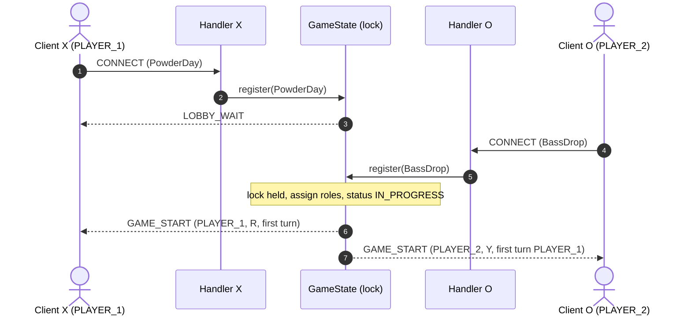
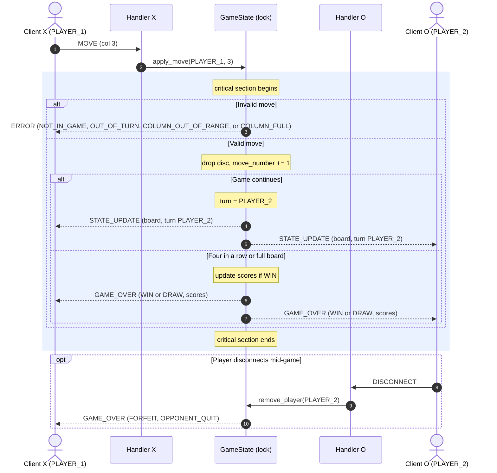

# Sprint 2: Server Concurrency Architecture

## 1. Choosing a Concurrency Model

I went with multi-threading for this server. I'm not starting from scratch here. In CS455 I built networked systems where many clients talked to one server at once, and the thread-per-connection pattern was the one I understood best. I know where it gets tricky, which is shared state, and that's where I've spent most of my design time.

The main thread only accepts connections. Each client gets its own handler thread, and that thread does all the blocking `recv()` calls for that socket. If one player is slow or stuck, only their handler waits. The accept loop and the other player keep going.

All shared game state lives in one `GameState` object, protected by one `threading.Lock`. In CS455 the bugs that cost me the most time were lock-ordering problems, where two threads each held a lock the other one needed. A single lock avoids that entirely. It's a blunt tool, but for a two-player game it's the right size.

The server accepts two players. A third connection is refused and closed.

## 2. Connection Lifecycle

| Phase | Thread | What happens |
|---|---|---|
| Listen | Main | Bind and listen on the server port. |
| Accept | Main | Accept a connection and start a handler thread for it. |
| Register | Handler | On `CONNECT`, call `GameState.register()`. Under the lock, check the alias, then assign `PLAYER_1` (R) or `PLAYER_2` (Y). The first player gets `LOBBY_WAIT`. The second triggers `GAME_START` to both. |
| Game loop | Handler | Parse incoming frames and pass each `MOVE` to `GameState.apply_move()`. |
| Teardown | Handler | On `DISCONNECT`, EOF, or a socket error, call `GameState.remove_player()`. This forfeits any running game, sends `GAME_OVER` to the remaining player, and closes the socket. |

Parsing happens outside the lock. `LineReader`, JSON decoding, and frame type checks all run in the handler thread. Only the game logic runs under the lock, so the critical section stays short.

## 3. Shared State and Locking

Figuring out what is actually shared was the hardest part of this sprint. These are the fields that only get read or written while holding `GameState.lock`:

| Field | Written by |
|---|---|
| `board` (6x7 grid) | `apply_move`, round reset |
| `turn` | `apply_move` |
| `status` | `register`, `apply_move`, `remove_player` |
| `players` (role to handler) | `register`, `remove_player` |
| `move_number` | `apply_move` |
| `scores` | `apply_move` (on win) |

Each socket is touched only by its own handler thread, so socket reads never need the lock. I deliberately keep the lock out of `recv()`. If I held it while waiting on a slow client, I'd be recreating the blocking problem I was trying to avoid.

Each move is one critical section. Validation, disc placement, the win or draw check, the turn update, and the broadcast all happen under the lock. That's the part I'm most careful about. If the board changes halfway through a broadcast, the two players could see different games, and that is exactly the kind of inconsistency I learned to watch for in CS455. Holding the lock for the whole move means both players get the same updates in the same order.

```python
def apply_move(self, role, col):
    with self.lock:
        error = self._validate(role, col)
        if error:
            self._send(self.players[role], error)
            return
        row = self._drop_disc(col)
        self.move_number += 1
        result = self._check_result(row, col)  # "WIN", "DRAW", or None
        if result is None:
            self.turn = "PLAYER_2" if role == "PLAYER_1" else "PLAYER_1"
            self._broadcast(state_update(self.board, row, col, role, self.turn, self.move_number))
        else:
            if result == "WIN":
                self.scores[role] += 1
            self.status = "GAME_OVER"
            self._broadcast(game_over(result, role, self.board, self.scores))
```

**Known limitation:** `sendall()` runs under the lock, so a client that stops reading could stall the game once its buffer fills. The messages are small, so I'm accepting that risk for now. If I had more time, I'd move sends to a per-client outbound queue with a writer thread, which is a pattern I'd like to explore further.

## 4. Move Flow and Turn Enforcement

Every move goes through the same checks, in order, under the lock:

1. Is the game in progress? If not, `NOT_IN_GAME`.
2. Is it this player's turn? If not, `OUT_OF_TURN`.
3. Is the column between `0` and `6`? If not, `COLUMN_OUT_OF_RANGE`.
4. Does the column have room? If not, `COLUMN_FULL`.

A rejected move returns an `ERROR` to the sender only, and the board doesn't change. I want the server to be the one place that decides what's legal. Clients can send whatever they like, and the server just says no.

## 5. Scores and Results

Scores live in `GameState.scores` and only change when a player wins. A draw doesn't change anything. Each `GAME_OVER` carries the full score table, and both players get it in the same critical section, so they always see the same totals.

## 6. Sequence Diagrams

### 6.1 Join and Start



### 6.2 Move, Validation, and Broadcast


