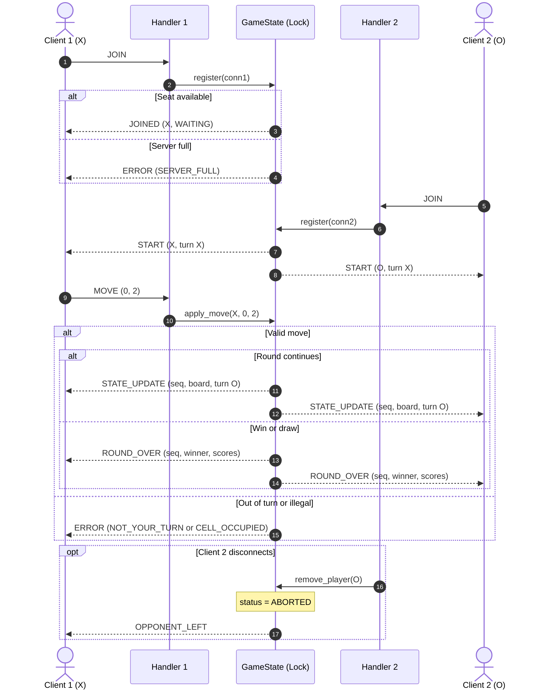

# Sprint 2: Server Concurrency Architecture

## 1. Concurrency Model

I'm using multi-threading due to my experience in CS455. The main thread accepts connections, and each client gets its own handler thread. Each handler's blocking `recv()` only affects its own client.

All shared game state lives in one `GameState` object guarded by one `threading.Lock`. A single lock means there is no lock ordering to get wrong, so deadlocks from lock ordering aren't possible.

The server accepts two players. A third connection receives `ERROR (SERVER_FULL)` and is closed.

## 2. Connection Lifecycle

| Phase | Thread | What happens |
|---|---|---|
| Listen | Main | Bind and listen on the server port. |
| Accept | Main | Accept a connection and start a `ClientHandler` thread. |
| Register | Handler | On `JOIN`, call `GameState.register()`. Under the lock, assign `X` or `O`, or refuse if both seats are taken. |
| Game loop | Handler | Read messages and pass `MOVE` to `GameState.apply_move()`. |
| Teardown | Handler | On disconnect, call `remove_player()`, which frees the seat, aborts the game, and sends `OPPONENT_LEFT` to the other player. |

## 3. Shared State and Locking

These fields are read or written only while holding `GameState.lock`:

| Field | Written by |
|---|---|
| `board` | `apply_move`, round reset |
| `current_turn` | `apply_move` |
| `status` | `register`, `apply_move`, `remove_player` |
| `players` | `register`, `remove_player` |
| `scores` | `apply_move` (round end) |
| `seq` | every broadcast |

Each socket is touched only by its own handler thread, so socket reads never take the lock. The lock is never held during `recv()`, so one slow client can't block the other.

Each move is one critical section. Validation, board update, `seq` increment, and broadcast all happen under this lock, so both clients receive the same updates in the same order.

```python
def apply_move(self, symbol, row, col):
    with self.lock:
        error = self._validate(symbol, row, col)
        if error:
            self._send(self.players[symbol], error)
            return
        self.board[row][col] = symbol
        winner = self._check_winner_or_draw()
        self.seq += 1
        if winner is None:
            self.current_turn = 'O' if symbol == 'X' else 'X'
            self._broadcast(state_update(self.seq, self.board, self.current_turn))
        else:
            if winner in ('X', 'O'):
                self.scores[winner] += 1
            self.status = 'ROUND_OVER'
            self._broadcast(round_over(self.seq, winner, self.scores))
            self._reset_board()
```


## 4. Turn Enforcement / Scoring

Validation runs under the lock, in this order:

1. Game is `IN_PROGRESS`, otherwise `GAME_NOT_ACTIVE`.
2. It's the sender's turn, otherwise `NOT_YOUR_TURN`.
3. Row and column are in `0–2`, otherwise `OUT_OF_BOUNDS`.
4. The cell is empty, otherwise `CELL_OCCUPIED`.

A rejected move never changes state.

Scores change only when a round is won. A draw changes nothing. `ROUND_OVER` includes the full score table, so both clients show the same totals.

## 5. Messages

| Message | Direction | Payload |
|---|---|---|
| `JOIN` | Client → Server | none |
| `JOINED` | Server → Client | symbol, status |
| `START` | Server → Both | symbols, first turn |
| `MOVE` | Client → Server | row, col |
| `STATE_UPDATE` | Server → Both | seq, board, turn |
| `ROUND_OVER` | Server → Both | seq, winner, scores |
| `OPPONENT_LEFT` | Server → Remaining | none |
| `ERROR` | Server → Sender | error code |

## 6. Sequence Diagram


