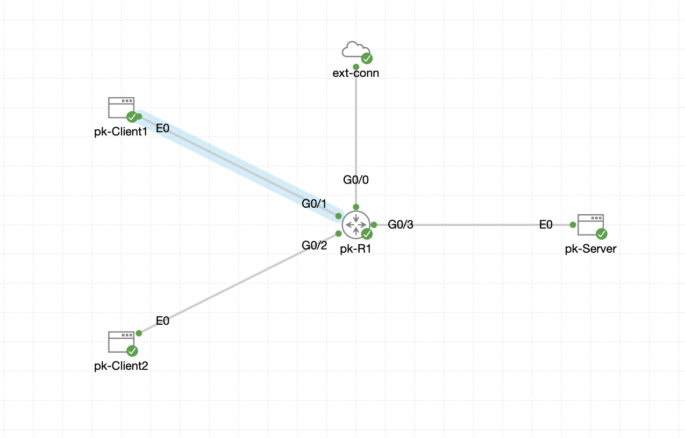
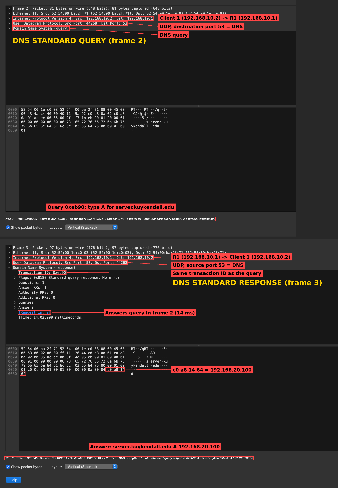

# Sprint 4 Network Verification Report

**Name:** Parker Kuykendall
**Game server hostname:** `server.kuykendall.edu`

## 1. Topology



One router (pk-R1) connects all three subnets directly, so no static routes are needed between them. R1 also hands out DHCP leases to both clients and answers DNS for the game server's name. Gi0/0 goes to the External Connector so the nodes can reach the internet through NAT.

| Node | Interface | IP address | How it gets the address |
|---|---|---|---|
| pk-R1 | Gi0/0 | 192.168.255.6/24 | DHCP from the External Connector (NAT outside) |
| pk-R1 | Gi0/1 | 192.168.10.1/24 | static, gateway for Subnet A |
| pk-R1 | Gi0/2 | 192.168.11.1/24 | static, gateway for Subnet B |
| pk-R1 | Gi0/3 | 192.168.20.1/24 | static, gateway for Subnet C |
| pk-Client1 | eth0 | 192.168.10.2/24 | DHCP from CLIENT1_POOL |
| pk-Client2 | eth0 | 192.168.11.2/24 | DHCP from CLIENT2_POOL |
| pk-Server | eth0 | 192.168.20.100/24 | static, gateway 192.168.20.1 |

The full router config is in [`sprint_4_r1_config.txt`](sprint_4_r1_config.txt).

## 2. Router R1

### show ip interface brief

All four Gigabit interfaces are `up` / `up`. Gi0/1-0/3 have the three gateway addresses, and Gi0/0 got 192.168.255.6 from the External Connector.

```text
R1#show ip interface brief
Interface                  IP-Address      OK? Method Status                Protocol
GigabitEthernet0/0         192.168.255.6   YES DHCP   up                    up      
GigabitEthernet0/1         192.168.10.1    YES TFTP   up                    up      
GigabitEthernet0/2         192.168.11.1    YES TFTP   up                    up      
GigabitEthernet0/3         192.168.20.1    YES TFTP   up                    up      
NVI0                       unassigned      YES unset  up                    up      
```

### show ip route

Subnets A, B and C all show up as `C` (connected) routes, so R1 routes between them without any `ip route` commands. The default route out to 192.168.255.1 came from the DHCP lease on Gi0/0.

```text
R1#show ip route
Codes: L - local, C - connected, S - static, R - RIP, M - mobile, B - BGP
       D - EIGRP, EX - EIGRP external, O - OSPF, IA - OSPF inter area 
       N1 - OSPF NSSA external type 1, N2 - OSPF NSSA external type 2
       E1 - OSPF external type 1, E2 - OSPF external type 2
       i - IS-IS, su - IS-IS summary, L1 - IS-IS level-1, L2 - IS-IS level-2
       ia - IS-IS inter area, * - candidate default, U - per-user static route
       o - ODR, P - periodic downloaded static route, H - NHRP, l - LISP
       a - application route
       + - replicated route, % - next hop override, p - overrides from PfR

Gateway of last resort is 192.168.255.1 to network 0.0.0.0

S*    0.0.0.0/0 [254/0] via 192.168.255.1
      192.168.10.0/24 is variably subnetted, 2 subnets, 2 masks
C        192.168.10.0/24 is directly connected, GigabitEthernet0/1
L        192.168.10.1/32 is directly connected, GigabitEthernet0/1
      192.168.11.0/24 is variably subnetted, 2 subnets, 2 masks
C        192.168.11.0/24 is directly connected, GigabitEthernet0/2
L        192.168.11.1/32 is directly connected, GigabitEthernet0/2
      192.168.20.0/24 is variably subnetted, 2 subnets, 2 masks
C        192.168.20.0/24 is directly connected, GigabitEthernet0/3
L        192.168.20.1/32 is directly connected, GigabitEthernet0/3
      192.168.255.0/24 is variably subnetted, 2 subnets, 2 masks
C        192.168.255.0/24 is directly connected, GigabitEthernet0/0
L        192.168.255.6/32 is directly connected, GigabitEthernet0/0
```

### show ip dhcp binding

Both clients have an active lease, each on its own subnet. The `.1` addresses were excluded, so the first address handed out in each pool is `.2`.

```text
R1#show ip dhcp binding
Bindings from all pools not associated with VRF:
IP address          Client-ID/              Lease expiration        Type
                    Hardware address/
                    User name
192.168.10.2        0152.5400.ba2f.71       Nov 21 2026 11:56 PM    Automatic
192.168.11.2        0152.5400.ddfd.46       Nov 21 2026 11:58 PM    Automatic
```

### show hosts

The static A record for the game server, from `ip host server.kuykendall.edu 192.168.20.100`.

```text
R1#show hosts
Default domain is not set
Name/address lookup uses domain service
Name servers are 192.168.255.1

Codes: UN - unknown, EX - expired, OK - OK, ?? - revalidate
       temp - temporary, perm - permanent
       NA - Not Applicable None - Not defined

Host                      Port  Flags      Age Type   Address(es)
server.kuykendall.edu     None  (perm, OK)  0   IP    192.168.20.100
```

## 3. Game Server (pk-Server)

The server has the static address `192.168.20.100/24` and a default route via `192.168.20.1`. Without that default route, pings from the clients would reach the server but the replies would have nowhere to go.

```text
pk-Server:~$ ip addr show eth0
2: eth0: <BROADCAST,MULTICAST,UP,LOWER_UP> mtu 1500 qdisc pfifo_fast state UP qlen 1000
    link/ether 52:54:00:f4:e0:db brd ff:ff:ff:ff:ff:ff
    inet 192.168.20.100/24 scope global eth0
       valid_lft forever preferred_lft forever
    inet6 fe80::5054:ff:fef4:e0db/64 scope link 
       valid_lft forever preferred_lft forever
pk-Server:~$ ip route
default via 192.168.20.1 dev eth0 
192.168.20.0/24 dev eth0 scope link  src 192.168.20.100 
```

## 4. Client 1 (pk-Client1)

Client 1 got 192.168.10.2 from R1, along with the default gateway 192.168.10.1 and the DNS server 192.168.10.1. It pings the server across the router with 0% packet loss and resolves `server.kuykendall.edu` to 192.168.20.100.

```text
pk-Client1:~$ sudo udhcpc -i eth0
udhcpc: started, v1.37.0
udhcpc: broadcasting discover
udhcpc: broadcasting select for 192.168.10.2, server 192.168.10.1
udhcpc: lease of 192.168.10.2 obtained from 192.168.10.1, lease time 86400
pk-Client1:~$ ip addr show eth0
2: eth0: <BROADCAST,MULTICAST,UP,LOWER_UP> mtu 1500 qdisc pfifo_fast state UP qlen 1000
    link/ether 52:54:00:ba:2f:71 brd ff:ff:ff:ff:ff:ff
    inet 192.168.10.2/24 scope global eth0
       valid_lft forever preferred_lft forever
    inet6 fe80::5054:ff:feba:2f71/64 scope link 
       valid_lft forever preferred_lft forever
pk-Client1:~$ ip route
default via 192.168.10.1 dev eth0  metric 202 
192.168.10.0/24 dev eth0 scope link  src 192.168.10.2 
pk-Client1:~$ cat /etc/resolv.conf
nameserver 192.168.10.1
pk-Client1:~$ ping -c 4 192.168.20.100
PING 192.168.20.100 (192.168.20.100): 56 data bytes
64 bytes from 192.168.20.100: seq=0 ttl=42 time=14.719 ms
64 bytes from 192.168.20.100: seq=1 ttl=42 time=4.264 ms
64 bytes from 192.168.20.100: seq=2 ttl=42 time=2.584 ms
64 bytes from 192.168.20.100: seq=3 ttl=42 time=3.607 ms

--- 192.168.20.100 ping statistics ---
4 packets transmitted, 4 packets received, 0% packet loss
round-trip min/avg/max = 2.584/6.293/14.719 ms
pk-Client1:~$ nslookup -type=A server.kuykendall.edu
Server:         192.168.10.1
Address:        192.168.10.1:53

Non-authoritative answer:
Name:   server.kuykendall.edu
Address: 192.168.20.100
```

## 5. Client 2 (pk-Client2)

Client 2 got 192.168.11.2 from the second pool, with gateway and DNS server 192.168.11.1. Ping and DNS both work the same way as on Client 1.

```text
pk-Client2:~$ sudo udhcpc -i eth0
udhcpc: started, v1.37.0
udhcpc: broadcasting discover
udhcpc: broadcasting select for 192.168.11.2, server 192.168.11.1
udhcpc: lease of 192.168.11.2 obtained from 192.168.11.1, lease time 86400
pk-Client2:~$ ip addr show eth0
2: eth0: <BROADCAST,MULTICAST,UP,LOWER_UP> mtu 1500 qdisc pfifo_fast state UP qlen 1000
    link/ether 52:54:00:dd:fd:46 brd ff:ff:ff:ff:ff:ff
    inet 192.168.11.2/24 scope global eth0
       valid_lft forever preferred_lft forever
    inet6 fe80::5054:ff:fedd:fd46/64 scope link 
       valid_lft forever preferred_lft forever
pk-Client2:~$ ip route
default via 192.168.11.1 dev eth0  metric 202 
192.168.11.0/24 dev eth0 scope link  src 192.168.11.2 
pk-Client2:~$ cat /etc/resolv.conf
nameserver 192.168.11.1
pk-Client2:~$ ping -c 4 192.168.20.100
PING 192.168.20.100 (192.168.20.100): 56 data bytes
64 bytes from 192.168.20.100: seq=0 ttl=42 time=7.570 ms
64 bytes from 192.168.20.100: seq=1 ttl=42 time=5.534 ms
64 bytes from 192.168.20.100: seq=2 ttl=42 time=4.219 ms
64 bytes from 192.168.20.100: seq=3 ttl=42 time=4.661 ms

--- 192.168.20.100 ping statistics ---
4 packets transmitted, 4 packets received, 0% packet loss
round-trip min/avg/max = 4.219/5.496/7.570 ms
pk-Client2:~$ nslookup -type=A server.kuykendall.edu
Server:         192.168.11.1
Address:        192.168.11.1:53

Non-authoritative answer:
Name:   server.kuykendall.edu
Address: 192.168.20.100
```

## 6. Wireshark DNS Capture

The capture is in [`sprint_4_dns_lookup.pcap`](sprint_4_dns_lookup.pcap). I captured on the link between pk-Client1 (eth0) and pk-R1 (Gi0/1) while running `nslookup -type=A server.kuykendall.edu` on pk-Client1. With the `dns` display filter, the capture shows exactly one query and one response.



| | DNS Standard Query | DNS Standard Response |
|---|---|---|
| Frame | 2 | 3 |
| Source | 192.168.10.2 : 44268 | 192.168.10.1 : 53 |
| Destination | 192.168.10.1 : 53 | 192.168.10.2 : 44268 |
| Transport | UDP | UDP |
| Transaction ID | 0xeb90 | 0xeb90 |
| Question | `server.kuykendall.edu`, type A, class IN | same |
| Answer | none | `server.kuykendall.edu` A `192.168.20.100` (TTL 10) |
| Frame length | 81 bytes | 97 bytes |

Client 1 sends a standard query over UDP to port 53 on its gateway, which is the DNS server it got from DHCP. R1 answers from its own host table, using the `ip host` entry, with the A record `192.168.20.100`. The response comes back about 14 ms later with the same transaction ID, which is how the client matches it to its query.

Both clients print "Non-authoritative answer", and the response doesn't have the AA (authoritative) flag set. That's just how IOS answers from its `ip host` table. The address it returns is still the one I configured on R1, and no other DNS server was asked.

